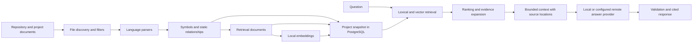

# Lens architecture

Lens is a local repository indexing and grounded retrieval application with a command-line interface. It uses a two-stage retrieval-augmented generation (RAG) design: indexing turns a project into searchable evidence once; question answering retrieves a bounded subset of that evidence before asking a configured model to respond. The complete stage-by-stage explanation, including the theory behind parsing, chunking, embeddings, ranking, evidence context, and answer validation, is in [How Lens understands a project and answers questions](rag-pipeline.md).

Its main stages are:

Parsing, relationship discovery, retrieval, and provider integration are separate modules connected by typed knowledge objects and store/provider interfaces. Index updates are persisted as a project-scoped snapshot. Lexical and vector search produce independent candidate sets, which are merged and ranked using query-aware signals. Selected evidence can be expanded through known static relationships for cross-layer questions, then bounded and passed to the answer provider with source identifiers. Structural and citation checks validate the response shape, but do not prove semantic entailment of every claim.

Lens does not execute the indexed application. Its application database question workflow is separate: it inspects metadata from a configured application database and can execute only a confirmed, validated read-only query.

See the [source map](../reference/source-map.md) for each source file and its public functions.
