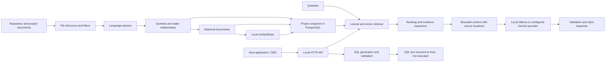

# Lens architecture

Lens has two interaction surfaces over one indexing and answer core: a developer CLI and a local HTTP service for host applications. Both use the repository parser, PostgreSQL/pgvector store, lexical/vector retrieval, context construction, model adapters, and shared answer validation. The HTTP service fixes one configured repository root; clients cannot switch projects per request. The complete stage-by-stage explanation is in [How Lens understands a project and answers questions](rag-pipeline.md).

Its main stages are:

Parsing, relationship discovery, retrieval, and provider integration are separate modules connected by typed knowledge objects and store/provider interfaces. Index updates are persisted as a project-scoped snapshot. Lexical and vector search produce independent candidate sets, which are merged and ranked using query-aware signals. Selected evidence can be expanded through known static relationships for cross-layer questions, then bounded and passed to the answer provider with source identifiers. Structural and citation checks validate the response shape, but do not prove semantic entailment of every claim.

Lens does not execute the indexed application. Application-data SQL generation is separate from repository RAG: Lens reads configured schema metadata and returns one validated read-only SQL statement. The SDK/API never executes SQL or returns application rows. The developer CLI retains a separate explicit-confirmation path for bounded read-only execution. Host applications remain responsible for authentication, authorization, and any SQL execution policy. The deployment, endpoint contract, setup, reindexing, persistence, and security model are documented in [Local deployment and release contract](../release/deployment.md).

See the [source map](../reference/source-map.md) for each source file and its public functions.
